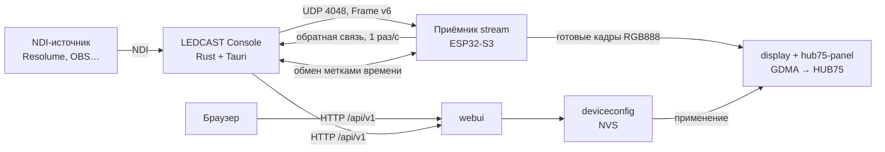

# Архитектура LEDCAST

Документ описывает, как устроена система и почему ключевые решения приняты
именно так. Он заменяет прежний набор ADR: здесь только то, что соответствует
текущему коду.

## Система целиком



Словарь:

- **Строка (line)** — один контроллер HD‑WF2 и одна цепочка HUB75‑модулей на
  его разъёме. Каждая строка адресуется отдельно и получает свой поток.
- **Модуль** — одна физическая панель HUB75. В строке их 1…24.
- **Полотно** — логическое RGB‑изображение строки: ширина = ширина модуля ×
  число модулей, высота = высота модуля.
- **Кадр источника** — RGB888 из NDI после маппинга на полотно.

Десктоп ничего не знает о монтаже: он шлёт полотно в логическом порядке слева
направо. Всё, что зависит от физики конкретной строки — порядок модулей,
повороты, скан, драйверы, — знает только контроллер.

## Линейная модель строки

Компонент `linear`. Строка хранит тип модуля, число модулей и перестановку:
для каждой видимой позиции — номер физического модуля в цепочке и флаги
`rotate_180`, `mirror_x`, `mirror_y`. Разрешение вычисляется, а не хранится.

**Почему так.** Ранняя версия описывала геометрию креста из лучей, граней и
осей. Для бегущих строк это давало ложные состояния во всех слоях —
конфигурации, протоколе, API и интерфейсе. Одна линейная модель одинакова везде
и проверяется host‑тестами (`test_linear`). Отправлять кадр в физическом порядке
отвергнуто: тогда десктоп должен был бы знать монтаж каждой строки.

## Видеотранспорт: LEDCAST Frame v6

Отправитель — `desktop/src/stream.rs` и часы `desktop/src/clock.rs`, приёмник —
`firmware/components/stream` (часы — `stream_clock.h`).

### Формат

UDP, порт 4048. Каждая датаграмма — заголовок 72 байта (магия `LCF6`, версия 6)
и до 1200 байт полезной нагрузки, чтобы датаграмма заведомо помещалась в MTU.
Заголовок несёт:

- `session_id` (64 бит), `stream_id`, `frame_id` — однозначная принадлежность
  пакета кадру и сеансу;
- `pts_ns` — момент показа на часах Console, `rate_n/rate_d` — частота
  источника;
- `width`, `height`, `decoded_bytes` — геометрия кадра, проверяется каждым
  кадром;
- `codec` — `Raw` (RGB888), `Lz4` (блок LZ4 от RGB888) или `Repeat` (тот же
  кадр, что предыдущий), `encoded_bytes`;
- `frame_crc32` — CRC32 декодированного кадра;
- `chunk_index`, `data_chunk_count` и тип пакета: данные или чётность;
- `clock_port` — UDP‑порт, на котором Console отвечает на обмен метками времени.

Каждый кадр независим: никакой ссылки на предыдущий кадр нет, кроме `Repeat`.
Отправитель выбирает LZ4, только если он короче сырого кадра, добавляет один
пакет чётности (XOR всех пакетов данных) и раскладывает пакеты по трём
четвертям периода кадра, а не одной пачкой.

### Часы и время показа

Время показа кадра — момент его захвата из NDI плюс задержка показа, одна на
все строки (25, 50, 75 или 100 мс, по умолчанию 100). Так один и тот же кадр источника
несёт на всех строках один и тот же `pts_ns`, а отправка кадра от времени
показа не зависит: кадр уходит, как только источник его дал.

Строка переводит `pts_ns` на свои часы сама, по обмену метками как в NTP
(пакеты `LCK6`, 40 байт). Сетевая задача строки шлёт на `clock_port` Console
запрос со своим временем `t1`, Console отвечает временем приёма `t2` и отправки
`t3` по своим часам, строка отмечает приход ответа `t4`:

- путь туда и обратно — `(t4 − t1) − (t3 − t2)`;
- смещение часов — `((t2 − t1) + (t3 − t4)) / 2`.

Из последних 16 обменов берётся обмен с самым коротким путём: ошибку смещения
даёт только несимметрия пути, а её почти нет у обмена, не стоявшего в очереди
Wi‑Fi. Запросы идут раз в 50 мс, пока окно не набрано, дальше раз в 250 мс,
чтобы успевать за уходом кварца. Ответ засчитывается только от адреса
источника и с идентификатором текущего сеанса; новый сеанс сбрасывает часы.
Показ начинается после четырёх обменов.

Ответчик в Console один на процесс, на своём сокете и в своём потоке: его
метки не зависят от того, чем заняты потоки отправки.

### Приём и показ

Кадр живёт в одном буфере (слоте) от первого пакета до показа, копий нет:

1. Сетевая задача (ядро 0) пишет пакеты прямо в слот кадра: сырой кадр — с
   начала буфера, LZ4 — в конец, откуда он распакуется в начало. Пакеты
   старых кадров и чужих сеансов отбрасываются. Буфер чётности берётся из
   общего пула на четыре кадра в приёме; если кадров в приёме больше, лишний
   собирается без FEC. Там же идёт обмен метками времени.
2. Если не хватает ровно одного пакета данных, он восстанавливается из
   чётности.
3. Задача декодирования (ядро 1) распаковывает LZ4 на месте, в начало того же
   слота (запас за кадром — `(размер >> 8) + 32` байта), и проверяет CRC32.
   Кадр с ошибкой отбрасывается целиком. `Repeat` слота не занимает: если
   кадр, который он повторяет, ещё в слоте или на панели, повтор просто
   отмечается, панель держит ту же картинку.
4. Проверенный кадр ждёт времени показа в своём же слоте. Слотов от четырёх до
   двадцати: при запуске приёма строка берёт столько, сколько остаётся сверх
   запаса сервисов (24 КиБ) и ещё 16 КиБ на всплески веба, загрузки прошивки
   и Wi‑Fi. До показа строка держит `слоты − 1` кадр; это число она сообщает
   Console.
5. Задача рендера (ядро 1, высший приоритет) идёт по сетке кадров вывода
   (см. «Сетка кадров»): на каждой точке сетки переводит момент показа на часы
   Console и берёт самый новый кадр, чьё время наступило (с допуском в
   полшага сетки), переносит его из слота на HUB75 и сразу освобождает слот.
   Нового кадра нет — панель держит прежний. Если свободных слотов нет, а
   время ни одного кадра не пришло (задержка больше, чем строка удерживает),
   показывается самый ранний: строка не встаёт, но уходит вперёд остальных.

Сколько это стоит: строка из десяти модулей 32×16 — 15 КБ на кадр. С одинарным
DMA‑буфером ей остаётся пять слотов: 50 мс задержки при 60 кадрах/с или
100 мс при 30.

Раз в секунду приёмник отправляет обратно 72‑байтную сводку `LCB6`: последний
проверенный и показанный кадр, потери, восстановления по чётности, ошибки CRC,
джиттер прихода, глубину резерва и состояние часов. Console по ней показывает
состояние строки и опускает задержку для всех строк до той, что удерживает
самая короткая: `(глубина − 1) × период кадра`.

Если поток пропал дольше 2 с, строка гаснет (или возвращается к автономному
показу).

### Почему так

- **Синхронность без синхронизатора.** Раньше каждая строка привязывала время
  кадров к своим часам в момент, когда набрала первые кадры, и больше эту
  привязку не правила; у каждой строки был и свой такт отправки в Console, а
  каждая пауза потока отправки навсегда сдвигала время показа вперёд. Строки
  расходились на десятки миллисекунд, кадры копились до переполнения памяти, и
  строка начинала терять пакеты. Общие часы Console и время показа от момента
  захвата убирают все три причины. Точность — доли миллисекунды по часам плюс
  полшага сетки вывода (≤ 4,2 мс при 120 кадрах/с), меньше кадра источника.
- **Задержка ограничена памятью, а не сетью.** Кадр ждёт показа в буфере
  строки, а PSRAM на плате нет. Поэтому задержка общая и опускается до той,
  что удерживает самая короткая строка: иначе строки разойдутся.
- **Целостность.** Под потерями и переупорядочиванием Wi‑Fi кадр никогда не
  собирается из двух разных кадров источника: идентификатор кадра в каждом
  пакете и CRC всего кадра. Отсюда отказ от DDP — у DDP только 4‑битный номер
  пакета без сеанса и кадра, и опоздавший пакет загрязнял следующий кадр
  цветными точками.
- **Нет повторных передач.** Нет TCP (потеря пакета превращается в растущую
  задержку) и нет переспросов: для живого видео выбросить один кадр лучше,
  чем задержать все последующие.
- **Цвет без потерь.** RGB888 едет до контроллера без квантования; единственное
  преобразование sRGB → ШИМ делает сам контроллер. Сжатие с потерями (RGB565,
  видеокодеки) отвергнуто, LZ4 сжимает статику и текст без потерь.
- **Независимые кадры.** Промежуточная версия передавала дельты от предыдущего
  кадра; потеря базы означала потерю картинки до следующего опорного кадра.
  Независимые кадры с LZ4 и одним пакетом чётности проще и восстанавливаются
  сразу на следующем кадре.

Цена решения: протокол специфичен для LEDCAST, а прошивку и десктоп нужно
обновлять вместе. Высокоэнтропийное видео остаётся сырым, поэтому сетевой
бюджет — часть контракта: строка из 24 модулей 32×16 при 60 кадрах/с без
сжатия — около 18 Мбит/с, и все строки делят одну точку доступа. Приложение
показывает суммарный поток. Компьютер с Console лучше подключать к роутеру
кабелем: по Wi‑Fi каждый кадр занимает эфир дважды.

## Вывод на HUB75

Компоненты `display` (интерфейс, пересборка, яркость) и `hub75-panel`
(доработанный драйвер ESP32-HUB75-MatrixPanel-DMA на GDMA + LCD_CAM).

### Память DMA

Буферы битпланов и цепочки дескрипторов лежат во внутренней SRAM: PSRAM на
плате нет, а GDMA адресует только SRAM1 и SRAM2. Бюджет DMA ограничен константой
`kDmaPoolBytes` = 92 КиБ (`deviceconfig.h`). Буферы выделяются отдельными
блоками через `dma_pool_allocate` (непрерывность нужна только внутри блока — в
пределах строки адресов и кольца дескрипторов) и освобождаются целиком при
пересборке драйвера.

Драйвер первый раз поднимается до старта Wi‑Fi, пока куча не раздроблена.
Под сервисами остаётся гарантированный запас 24 КиБ
(`runtime_heap_budget.h`): если после выделения кадров его нет, конфигурация
отвергается, а HTTP‑запросы при нехватке памяти получают 503 до обработчика.

**Почему так.** Выделение буфера на каждую реконфигурацию без предела
необратимо дробило непрерывную память: Wi‑Fi и веб на другом ядре успевали
занять окно между освобождением и повторным выделением. Постоянный резерв всех
92 КиБ при старте решал дробление, но запирал 47–63 КиБ на коротких строках,
которых потом не хватало приёму видео. Бюджет с поблочным выделением даёт
известный потолок без постоянного резерва.

### Правило допустимости — только в прошивке

Сколько модулей влезает в бюджет при данной разрядности, числе копий кадра,
частоте шины и нижней границе обновления, считает одна функция —
`config_chain_capacity` (`config_model.cpp`). На ней построены
`config_validate` (отказ сохранить негодную конфигурацию с причиной),
`config_max_bit_depth` (потолок разрядности) и подбор глубины в драйвере.
Расход учитывает и битпланы, и дескрипторы.

`config_model.cpp` намеренно не знает ни про NVS, ни про cJSON: та же логика
собирается на хосте под тесты.

**Почему так.** Пока потолок считал веб по упрощённой формуле, он не знал про
дескрипторы и вторую копию кадра; объявленный потолок расходился с тем, что
принимал драйвер, и тот молча опускал глубину.

### BCM: веса битпланов — степени двойки

Кадр выводится двоичной модуляцией: один проход по всем битпланам, затем
повторы планов выше точки перелома.

```
вес(план) = 1                    при план ≤ точка перелома
вес(план) = 2^(план − точка)     выше точки перелома
```

Формула записана один раз (`config_bcm_plane_weight`,
`config_bcm_extra_passes`); по ней работают раскладка дескрипторов, расчёт
памяти и модель частоты обновления. Планы ниже точки перелома добирают вес
окном OE, сужаемым вдвое на каждый план: разрешение младших битов
разменивается на частоту обновления. Точку выбирает расчёт развёртки под
частоту кадров (см. «Сетка кадров»).

**Почему так.** При неверных весах (1 : 2 : 3) комбинации `011` и `100` светят
одинаково — соседние уровни яркости сливаются. Это было видно как скважность
≈1/7 на белой заливке вместо двоичного соотношения.

### Цвет: гамма и упорядоченный дизеринг

Порядок обязателен (`colour.h`): **гамма → порог Bayer → квантование**.

- Таблица `kGamma16[256]` по CIE 1931 лежит в DRAM, а не во flash: путь
  горячий, а обращение Wi‑Fi к flash останавливает рендер на промахах кэша.
- Дизеринг — плитка Bayer 4×4 с индексом из координат точки. Состояния между
  пикселями нет, поэтому прогон, строка или отдельная точка считаются в любом
  порядке с одинаковым результатом.

**Почему так.** Диффузия ошибки строго последовательна вдоль строки, а кадр
пишется независимыми прогонами; на движении её ошибка ползёт за содержимым и
видна как шум. Гамма после квантования бессмысленна — растягивать можно только
ещё существующие уровни. Цена: на статичной плоской заливке видна текстура
плитки 4×4.

### Сетка кадров

У строки одна настройка частоты — `frame_rate`, 30, 60 или 120 кадров/с (по
умолчанию 120). По ней идут и видеопоток, и автономный показ; шина — 16 или
20 МГц (160 МГц делятся на 10 или 8 нацело).

Кадр меняется только на границе прохода кольца DMA. Расчёт развёртки
(`hub75_bcm::dma_memory`, общий для допуска конфигурации и драйвера) выбирает
точку перелома BCM так, чтобы на кадр приходилось k ≥ 2 проходов, а
развёртка шла не реже 120 Гц (при 30 кадрах/с — k ≥ 4: 60 Гц видно как
мерцание), и
растягивает проход тёмной добивкой (OE погашен, адрес не меняется) ровно до
1/(k·frame_rate) секунды. Добивка не больше 1/8 прохода, пока есть вариант
дешевле. Например, пять модулей P10 на 16 МГц при 120 кадрах: развёртка
360 Гц, кадр на каждый третий проход, добивка 2 % прохода.

Источники кадров ставят кадры через `FramePacer` (`frame_pacer.h`): следующий
кадр будет виден через k проходов после прошлого, картинка готовится на этот
момент, а кадр закрывается не раньше чем за полпрохода до нужной границы.

**Почему так.** Пока проход не делил период кадра нацело, кадры вставали то
через k, то через k+1 проходов: видео 60 кадров/с на сетке 137 Гц держало
кадры неровно (2‑2‑3), а таймер плейаута шёл в ритме источника мимо развёртки.
Цена добивки — до 1/8 яркости в худшем случае, обычно единицы процентов.

### Применение настроек на живой панели

`main.cpp` сравнивает новую конфигурацию с применённой и делает минимум:

- только яркость — переписываются биты OE в обеих копиях, поток не
  прерывается;
- порядок модулей, цвета, разрядность, частота, обновление — пересборка
  драйвера под одной «границей поколения», приёмник видео продолжает работать;
- размер полотна — приёмник перезапускается, его буферы зависят от размера.

Если применение не удалось, прежняя конфигурация восстанавливается, а кандидат
не публикуется и не пишется во flash.

## Конфигурация и хранение

Компонент `deviceconfig`. Настройки — неизменяемые снимки (`config_get`
возвращает удерживаемую ревизию), запись — сравнение с ожидаемой ревизией, так
что конкурентная правка из другой задачи отвергается, а не теряется.

Во flash настройки лежат в NVS (пространство `ledcast`) по доменам, каждый —
своим ключом с небольшим JSON‑документом:

| Ключ | Что внутри |
|---|---|
| `net` | сети Wi‑Fi, пароль и канал точки доступа, имя |
| `security` | вход в веб |
| `line` | тип модуля, число модулей, порядок и повороты |
| `output` | разрядность, копии кадра, шина, частота кадров, яркость |
| `show` | автономный показ |
| `stream` | приём видеопотока |

Граница доменов проходит по тому, что меняется вместе и что можно потерять
без поездки на площадку: сеть и вход отдельно от всего, вывод отдельно от
строки — его правят чаще всех (яркость), а раскладку модулей заново выставлять
дольше. JSON, а не типизированные ключи: недостающее поле берёт заводское
значение, лишнее не мешает, так что смена схемы внутри домена не стирает его
целиком.

При загрузке каждый домен читается, разбирается и проверяется сам
(`config_settle`, `config_domains.h`). Нет ключа, не разобрался, не прошёл
проверку — заводским становится только этот домен, с записью в журнал. Затем
проверяется единственная связь между доменами — строка с выводом должны влезть
в DMA‑пул (`config_max_bit_depth`). Если не влезают, первым уступает вывод:
сначала заводской, затем с глубиной, которая влезает; строка сбрасывается,
только если не влезает и при 2 битах. Сеть и вход в этом не участвуют. Шрифт
показа с высотой модуля не связан проверкой: веб ограничивает его при вводе и
при отдаче.

Запись отложенная, по очереди на домен (`config_flush_queue`): хранится только
последний текст, совпадающий с уже записанным не пишется. Ползунок яркости
переписывает лишь `output`, правка сети — лишь `net`.

`config_reset_factory` (10 с кнопки, «Заводской сброс» в вебе) сбрасывает все
домены, включая сеть и вход: это последний способ вернуть плату с забытым
паролем, после него она ждёт на точке доступа с заводским паролем. Забыть
только сети — 5 с кнопки.

Прошивки до разделения хранили всё одним документом под ключом `config`. При
первой загрузке новой прошивки из него переносятся только сеть и вход, ложатся
в `net` и `security`, и лишь после этого старый ключ стирается; остальное
старое отбрасывается, строку и вывод нужно задать заново.

Обновление по воздуху NVS не трогает: пишется только неактивная
OTA‑партиция и `otadata`. Полный образ `*-first-install.bin` пишется с адреса 0
и заполняет область NVS пустыми байтами — это установка с нуля, после неё все
настройки заводские. Обновления — только файлом `*-ota.bin`.

## Сеть и веб

- **Wi‑Fi** (`netconfig`): до 10 сохранённых сетей. Без подключения поднимается
  точка доступа `LEDCAST-XXXX` (192.168.4.1) с captive‑DNS, чтобы телефон сам
  открыл страницу настройки. Пока к точке подключён телефон, фоновые попытки
  STA не уводят радио с канала. Повторы подключения — с нарастающей паузой.
- **mDNS**: `ledcast-xxxx.local` (по MAC, как имя точки доступа), сервис `_ledcast._tcp` — по нему десктоп находит
  строки.
- **HTTP API** (`webui`), всё под `/api/v1`:

| Маршрут | Методы | Назначение |
|---|---|---|
| `/status` | GET | состояние строки, сети, вывода и видеопотока |
| `/hardware` | GET, PUT | модуль, порядок модулей, параметры вывода, `frame_rate` |
| `/brightness` | PUT | яркость без пересборки |
| `/show`, `/show/enabled` | GET, PUT | автономный показ текста |
| `/system` | GET, PUT | имя, пароль точки доступа, вход в веб |
| `/wifi/scan`, `/wifi/profiles[/*]` | GET, POST, DELETE | сети Wi‑Fi |
| `/auth/login`, `/auth/session` | POST, GET | вход по паролю |
| `/auth/challenge`, `/auth/console` | GET, POST | вход Console по ключу без пароля |
| `/test` | POST | тест‑паттерны: identify, grid, red, green, blue, gray |
| `/ota` | POST | обновление прошивки |
| `/reboot`, `/factory-reset` | POST | обслуживание |

Изменяющие запросы требуют токен входа (если вход включён), кроме запросов,
пришедших через собственную точку доступа контроллера — так плату можно
починить, стоя рядом. Запросы с чужого Origin отвергаются, вход ограничен
пятью попытками в минуту (общими для пароля и Console). Сессий до четырёх
сразу, на 12 ч: вход Console не выбивает браузер.

Console подключает строку паролем один раз и дальше входит ключом
`K = HMAC-SHA256(пароль, "ledcast-console:" + id)`: берёт одноразовый `nonce`
(`/auth/challenge`, 30 с) и отправляет `proof = hex(HMAC-SHA256(K, nonce))` в
`/auth/console`, получая токен сессии. Строка ключ не хранит, а считает при
входе, поэтому смена пароля отзывает все Console сразу. Ключи Console хранит в
`keys.json` рядом со своими настройками (доступ только у пользователя), пароль —
нигде.

Веб‑интерфейс (`firmware/web`) — один HTML со встроенными стилями и скриптом,
сжимается в gzip (≈20 КиБ при бюджете 100 КиБ) и вшивается в прошивку при
сборке. Внешних запросов страница не делает: на площадке интернета может не
быть.

## Живучесть

Компонент `health`.

- **OTA с откатом.** Две OTA‑партиции по 3,9 МБ. Новая прошивка подтверждается
  только после 45 с честного аптайма с работающей сетью; иначе загрузчик
  откатывается на прежнюю.
- **Безопасный режим.** Три неудачные загрузки подряд — плата поднимает только
  сеть, веб и OTA, без вывода на матрицу.
- **Тройное включение питания** вместо кнопки: плата стоит в корпусе, и на
  площадке, где её Wi‑Fi известен, а человека с доступом к нему нет, иначе
  строку не вывести из сети. Включение, после которого строка проработала
  меньше 5 с, засчитывается следующему (счёт в NVS, `power_cycles.h`); работа
  дольше 5 с серию сбрасывает. Третье включение подряд — автономный запуск:
  своя точка доступа без попыток уйти в сохранённые сети и встроенное шоу,
  если в нём есть текст (включается насовсем, выключается в веб‑интерфейсе).
  Загрузку окно не задерживает. Пока показывать нечего — ни шоу, ни потока, ни
  теста, — строка рисует счёт тремя квадратами с тающей полосой; на автономном
  запуске без шоу квадраты зелёные. Сброс по просадке считается включением:
  блок питания модулей разряжается медленно. Автономный запуск кончается
  следующим обычным включением или правкой Wi‑Fi из интерфейса.
- **Кнопка S1** (внутри корпуса): 5 с — забыть сети Wi‑Fi, 10 с — заводской
  сброс.
- **Ход обновления на строке.** Пока идёт OTA, поток и шоу стоят, а строка
  показывает полосу от красного к зелёному и процент во всю высоту.
- **Последняя паника** — причина, адрес и стек вызовов — переживает
  перезагрузку (до снятия питания) и приходит в `/status` как `last_panic`;
  адреса разбирает `addr2line` по `ledcast-node.elf` той же сборки.
- **Светодиод RUN** показывает фазу: загрузка, ожидание на точке доступа,
  подключение, работа, поток, ошибка.

## Автономный показ

Компонент `show`: статичный или бегущий текст (до 1024 байт, фразы через
перевод строки) встроенным шрифтом 7…14 px, своим цветом и скоростью. Пока показ
включён, видеопоток на матрицу не попадает.

- **Статика:** фраза по центру, смена каждые `duration_s`.
- **Бегущая строка:** все фразы стоят подряд на одной бесконечной ленте с
  зазором в три клетки знака; за последней снова идёт первая, одна фраза едет
  сама за собой. `duration_s` = 0 — фразы идут по очереди; иначе каждая фраза
  стоит на ленте блоком из стольких копий, сколько проезжает за `duration_s`, и
  за последней копией сразу въезжает следующая фраза. Смещение считается от момента включения и нигде не
  сбрасывается, поэтому стыков и рывков нет. Буфера под ленту нет: для каждого
  столбца экрана фраза и позиция в ней находятся двоичным поиском
  (`show_timing.h`).

Кадры бегущей строки идут по общей сетке кадров вывода, а позиция ленты
хранится в 1/256 точки: точка между двумя столбцами глифа светит долей
каждого, и доли складываются в линейном свете (`show_blend.h`), поэтому край
не тускнеет на ходу.

**Почему так.** Раньше кадр рисовался в дедлайн очередного целого пикселя и
закрывался когда придётся. На 70 точках/с при развёртке 61 Гц шаг выходил то
в одну, то в две точки, а момент показа гулял на целый проход — текст ехал
рывками. Целый шаг в принципе не даёт больше кадров, чем точек в секунду, так
что 120 кадров на медленной скорости возможны только с долями пикселя. Цена:
движущийся край размыт на одну точку.

## Тестирование

- `firmware/test` — host‑тесты на CTest: модель конфигурации и её ёмкость,
  загрузка по доменам и перенос старого документа, отложенная запись, линейная модель, разбор/сборка кадров
  Frame v6 и FEC, часы и выбор кадра по ним, BCM‑расписание, владение буферами DMA, цвет, сетевые политики,
  captive‑DNS, допуск HTTP. ESP‑IDF подменяется минимальными заглушками из
  `firmware/test/host`.
- `npm test` — логика обоих веб‑интерфейсов (модель линии, сети, автосохранение, Шоу в Console) на `node --test`.
- `desktop` — `cargo test`: маппинг полотна, кодер Frame v6, ответчик часов, настройки.

На железе проверяются только вещи, которые хост не воспроизводит: тайминги
GDMA, реальная частота обновления и поведение Wi‑Fi под нагрузкой.
